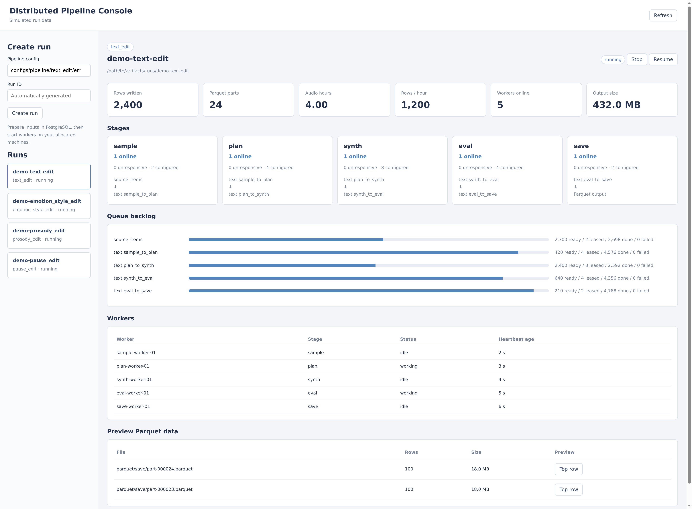

# dots.tts.edit Data Pipeline

[](LICENSE)
[](https://github.com/studio-dots-ai/dots.tts.edit)
[](https://arxiv.org/abs/2608.02673)
[](https://huggingface.co/dots-studio/dots.tts.edit)
[](https://dots-studio-dots-tts-edit.hf.space/)
[](https://dots-studio-dots-tts-edit-demo.static.hf.space)
[](https://github.com/studio-dots-ai/doteBench)

Tools and pipelines for creating speech-editing datasets at word and phrase
level. Four task families cover text replacement, insertion and deletion;
emotion and style; prosody; and pauses. Edits preserve the waveform outside
the affected regions, with timing controls defined by each task.

## Getting started

Clone the repository and its pinned upstream sources:

```bash
git clone --recurse-submodules https://github.com/studio-dots-ai/dots.tts.edit-data-pipeline
cd dots.tts.edit-data-pipeline
```

Install [uv](https://docs.astral.sh/uv/) and the system dependencies described in
the [environment guide](docs/environment-setup.md). Model-backed services need
a compatible NVIDIA driver. The pause-edit example below uses three Python
environments; inspect the installation plan, then install from the frozen locks:

```bash
bash scripts/setup_venvs.sh --env pipe-cpu --env pipe-gpu --env pipe-asr --dry-run
bash scripts/setup_venvs.sh --env pipe-cpu --env pipe-gpu --env pipe-asr
```

Provision model files separately under their respective licenses. For this
example, prepare the [F5-TTS model and Vocos vocoder](tools/f5-tts/README_services.md)
in a Hugging Face cache, and the
[Qwen3 forced aligner](tools/qwen3-asr/README_services.md) in
`$CHECKPOINTS_DIR/Qwen3-ForcedAligner-0.6B`. Set absolute paths outside the checkout:

```bash
export CHECKPOINTS_DIR=/path/to/model-cache
export HF_HUB_CACHE="$CHECKPOINTS_DIR"
export HF_HUB_OFFLINE=1
export TRANSFORMERS_OFFLINE=1
export ARTIFACT_DIR=/path/to/artifacts/edit-data-pipeline
```

`CHECKPOINTS_DIR` contains model inputs; `ARTIFACT_DIR` holds generated audio,
datasets, logs and runtime state. Input datasets have their own external paths.
Model weights and datasets are not bundled with the source. See
[model cache configuration](docs/environment-setup.md#model-caches-and-credentials)
and [artifact storage](docs/environment-setup.md#artifact-storage).

### Make a pause edit

The launcher starts the pause API and its alignment, synthesis and smoothing
dependencies. The generation-only profile uses the configured GPU 0 by default;
review its resolved commands and adjust service declarations for your machine:

```bash
envs/pipe-cpu/.venv/bin/python -m speech_edit.runtime.services \
  --config service/pause_edit_pipeline/defaults --dry-run
envs/pipe-cpu/.venv/bin/python -m speech_edit.runtime.services \
  --config service/pause_edit_pipeline/defaults
```

Keep that process running. In another terminal, check readiness:

```bash
curl --fail 'http://127.0.0.1:8037/health?deep=true'
```

Submit a WAV and its exact transcript to `/execute`. This example inserts a
pause between “Hello” and “world”; replace the file, transcript and instruction
together with your own input:

```bash
envs/pipe-cpu/.venv/bin/python - /path/to/source.wav \
  'Hello world.' 'Hello<pause act="ins" level="2"/> world.' <<'PY'
import base64
from pathlib import Path
import sys
import requests

audio_path, transcript, instruction = sys.argv[1:]
response = requests.post(
    "http://127.0.0.1:8037/execute",
    json={
        "audio": {
            "data": base64.b64encode(Path(audio_path).read_bytes()).decode("ascii"),
            "format": "wav",
        },
        "source_text": transcript,
        "instruction_st": instruction,
        "evaluate": False,
        "persist": True,
    },
    timeout=600,
)
response.raise_for_status()
result = response.json()
print(result["status"])
print(result["metadata"]["profile_dir"])
PY
```

The printed directory contains the saved result under `ARTIFACT_DIR`. The
response also includes base64 WAV audio and edit metadata. See the
[pause API](speech_edit/pipelines/pause/service/README.md) for reduction,
multiple pauses and evaluation options. Interrupt the launcher to stop its
managed services.

Invoke an existing Python interpreter and use `--env-root` to select service
environments; see the
[environment guide](docs/environment-setup.md#reuse-an-environment).
Service APIs have no built-in authentication and can access local paths. Run
them on a trusted private network and keep them off the public internet.

## Running and inspecting datasets

For batch generation, prepare Parquet inputs using the
[source dataset guide](configs/README.md#input-data), then follow the
[distributed runtime guide](speech_edit/runtime/README.md). Each input row
contains audio bytes, a transcript and duration. Configure source paths,
service environments, model caches and worker resources for your installation;
remote workers need access to the same input and artifact storage.

The [configuration guide](configs/README.md) explains pipeline variants, stage
queues and service dependencies. Connect an external PostgreSQL database, create
a run, and start workers locally or on machines allocated by your task system.

Interactive APIs are available for all four task families:

| Task | API guide |
| --- | --- |
| Text replacement, insertion and deletion | [Text editing](speech_edit/pipelines/text/service/README.md) |
| Emotion and style | [Emotion/style editing](speech_edit/pipelines/emotion/service/README.md) |
| Pitch and speaking rate | [Prosody editing](speech_edit/pipelines/prosody/service/README.md) |
| Pause insertion and reduction | [Pause editing](speech_edit/pipelines/pause/service/README.md) |

### Monitoring

The [distributed pipeline console](viewers/distributed-pipeline-console/README.md)
creates and controls runs, displays queue and worker state, and inspects
written Parquet files with sample details and audio playback. Run it locally;
use a secure tunnel when accessing a remote host.



*Console with simulated run data: production totals, stage workers and queue backlog.*

## Architecture


Pipeline workers sample utterances, construct edits, call model services over
HTTP, evaluate results and persist accepted samples. Each pipeline defines its
own stage graph; the diagram illustrates one possible topology. PostgreSQL
holds queues and runtime state, while shared storage holds payloads and Parquet
outputs. Workers run on externally allocated machines and coordinate through
the database.

```text
speech_edit/
  pipelines/       Text, emotion/style, prosody and pause flows and APIs
  runtime/         Stage workers, queues, run control and service lifecycle
  clients/         HTTP clients for tool services
  data/            Data formats, source readers and sampling
  evaluation/      Shared audio metrics and evaluation orchestration
configs/           Pipeline, stage, service and source configuration
tools/             Model and signal-processing services
envs/              Python dependency definitions and frozen locks
viewers/           Run control, monitoring and dataset inspection
tests/             Unit and contract tests
docs/              Environment, architecture and service guides
```

Six tools pin official upstream sources: F5-TTS, IndexTTS2, TED-TTS, SeedVC,
Qwen3-TTS and Qwen3-ASR. Service adapters and maintained patches live outside
those submodules. Upstream source and model licenses apply independently.
See [architecture and extension boundaries](docs/architecture.md),
the [service guide](docs/services-guide.md) and
[contributor guidance](AGENTS.md) for implementation and testing conventions.

## Citation

If you use this pipeline, please cite the
[dots.tts.edit paper](https://arxiv.org/abs/2608.02673):

```bibtex
@misc{wang2026dotsttsedit,
  title={dots.tts.edit: Precisely Controlled Speech Editing with a Continuous Autoregressive Model},
  author={Hankun Wang and Bohan Li and Shi Lian and Xiaoyu Gu and Jing Peng and Da Zheng and Yiwei Guo and Colin Zhang and Shuai Wang and Kai Yu},
  year={2026},
  eprint={2608.02673},
  archivePrefix={arXiv},
  primaryClass={cs.SD},
  doi={10.48550/arXiv.2608.02673},
  url={https://arxiv.org/abs/2608.02673}
}
```

Citation metadata is provided in [CITATION.cff](CITATION.cff).

## License

This project is licensed under the [Apache License 2.0](LICENSE). Third-party
submodules and model weights remain subject to their respective licenses.
